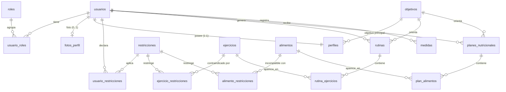

# Modelo de datos — `smartbody_db`

Motor: MySQL / MariaDB (XAMPP + phpMyAdmin). Codificacion `utf8mb4`, motor `InnoDB`. **17 tablas.**
Scripts: [`database/01_schema.sql`](../database/01_schema.sql) y
[`database/02_datos_iniciales.sql`](../database/02_datos_iniciales.sql).

## Diagrama entidad-relacion

## Tablas

| Tabla | Proposito | Requisito |
|-------|-----------|-----------|
| `roles` | Roles del sistema (`ROLE_USER`, `ROLE_ADMIN`) | RNF02 |
| `usuarios` | Cuentas. `password_hash` guarda el hash BCrypt | RF01, RF02 |
| `usuario_roles` | Relacion usuario–rol | RNF02 |
| `fotos_perfil` | Foto de perfil (JPG, PNG o WEBP de hasta 700 KB), separada para no cargarla en cada consulta | RF03 |
| `perfiles` | Edad, sexo, peso, altura, nivel, disponibilidad y objetivo | RF03, RF04 |
| `objetivos` | Catalogo de objetivos de entrenamiento | RF04 |
| `restricciones` | Catalogo de restricciones de salud y alimentacion | RF05 |
| `usuario_restricciones` | Restricciones declaradas por cada usuario | RF05 |
| `ejercicios` | Catalogo de ejercicios con grupo muscular, nivel y duracion | RF06, RF08 |
| `ejercicio_restricciones` | Ejercicios contraindicados para una restriccion de salud | RF06 |
| `alimentos` | Catalogo de alimentos con informacion nutricional, `preparacion` (para las recetas), `icono` (emoji) y `momentos` (comidas en que se recomienda) | Plan nutricional |
| `alimento_restricciones` | Alimentos incompatibles con una restriccion alimentaria | RF05 |
| `rutinas` | Rutina generada para un usuario | RF06, RF07 |
| `rutina_ejercicios` | Ejercicios de cada dia: series, repeticiones, tiempo y descanso | RF07, RF08 |
| `planes_nutricionales` | Plan nutricional asociado al objetivo | Plan nutricional |
| `plan_alimentos` | Alimentos del plan con cantidad y momento del dia | Plan nutricional |
| `medidas` | Historial de peso y medidas corporales | RF10 |

Las tablas `usuario_roles`, `usuario_restricciones`, `ejercicio_restricciones` y
`alimento_restricciones` son tablas de union necesarias para relaciones muchos a muchos.

## Reglas de integridad

- Claves primarias en todas las tablas y claves foraneas en cada relacion.
- `usuarios.email` y los `codigo` de catalogos son unicos.
- Borrado en cascada de los datos personales al eliminar un usuario
  (`perfiles`, `fotos_perfil`, `rutinas`, `planes_nutricionales`, `medidas`, restricciones y roles asociados).
- Restricciones `CHECK`: edad entre 12 y 100, peso y altura mayores que cero,
  1 a 7 dias por semana, 15 a 180 minutos por sesion, dia de rutina entre 1 y 7.
- Indices en los campos de busqueda frecuente: `usuario_id` en rutinas, planes y medidas;
  `tipo` en restricciones; `grupo_muscular` y `tipo` en ejercicios; `grupo` en alimentos.

## Datos iniciales

- 2 roles, 5 objetivos, 12 restricciones (6 de salud y 6 de alimentacion).
- 32 ejercicios con sus contraindicaciones y 32 alimentos con sus incompatibilidades, preparacion e icono.
- Todos los textos llevan tildes y ñ: importa los scripts con `utf8mb4`.
- Usuario de prueba `demo@smartbody.com` (contrasena `Smartbody123`) con perfil,
  restricciones de ejemplo e historial de 3 medidas.

La contrasena del usuario de prueba se guarda como hash BCrypt: el script **no contiene
contrasenas en texto plano** ni credenciales reales.
